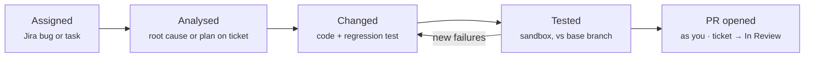
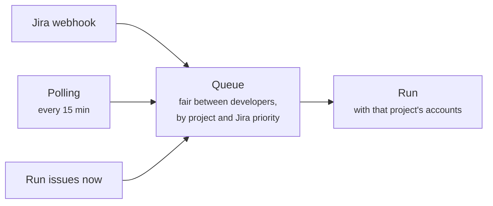
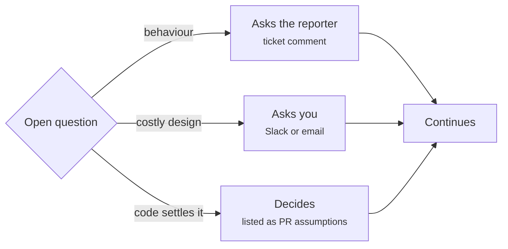
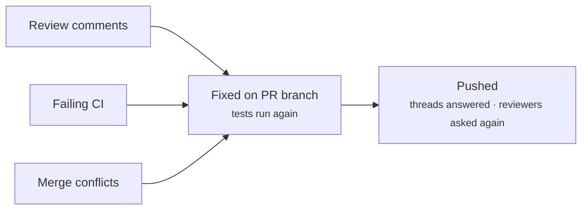
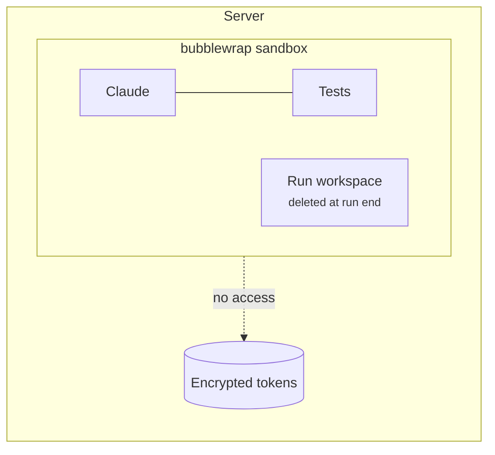

# ShadowDev at a glance

ShadowDev works on the Jira issues assigned to you, **as you**. It fixes them, tests the change, and
opens the PR. Details: [User guide](docs/USER-GUIDE.md), [Admin](docs/ADMIN.md), [Safety](docs/SAFETY.md). First run: [INSTALL.md](INSTALL.md).

## What it does

- **Bugs.** Root cause on the ticket, a regression test that fails without the fix, the fix version set.
- **Tasks and stories.** An implementation plan on the ticket, then the change.
- **Several repos.** One run changes frontend and backend, with a PR in each; or only the repos you tick.
- **Your conventions.** Follows each repo's CLAUDE.md, AGENTS.md, Copilot, Cursor and other AI rules.
- **Sent back.** Comment on a ticket after its PR and it works again, updating the same PR.
- **Right model.** Rates each issue: Haiku, Sonnet or your default; a stronger one takes over if needed.

## How work starts

- **By itself.** New assignments in chosen statuses and the active sprint start on their own.
- **Run issues now.** Keys or ranges: `MAR-1 to MAR-10 except MAR-3`.
- **Several at once.** In parallel, one after another (with a gap), or together on one branch.
- **Note for Claude.** Where to look, what to leave alone; for all issues or one. Never posted.
- **Priorities.** Runs at the same time and priority per project; urgent Jira issues first.

## When the issue is unclear

- **Assumptions.** What it decided itself is listed in the PR for reviewers to check.
- **Ask the reporter.** Missing steps or expected behaviour, on the ticket; resumes on their reply.
- **Ask you.** Public APIs, stored data, two valid designs; *Answer* fills in the next run.

## After the PR

- **How it publishes.** A PR, a draft PR, or only the branch for you to open.
- **Review requests.** Posted in the project's Slack channel, tagging each repo's reviewers.
- **Reminders.** Nobody reviewed it after a few hours? Reviewers are asked again.
- **Reviews for you.** Mention yourself with a PR link in Slack: it reviews, comments or approves.
- **Approve without review.** Branches you name, like `release/*` into `main`, are approved as you.

## Jira kept tidy

- **Status moves.** To In Progress, then In Review; back where it was if the run fails.
- **Status rules.** Moves finished tickets on once they have root cause, fix version, time logged.
- **Told what's missing.** Tickets a rule can't move yet are sent to you, with what each lacks.

## You stay in control

- **It is you.** Commits, PRs, comments and Slack messages use your accounts, in the first person.
- **Your switches.** Every automation is on or off per project, under Projects → Automation.
- **Working hours.** Work runs any time; PRs and comments others see wait for your hours.
- **Stop and pause.** Stop any run, or pause everything; settings are kept.
- **Recent runs.** Live progress, logs, time and cost; search, filter, delete.
- **Tell me.** Decisions and missing ticket fields by Slack, email, or only on the page.
- **Activity.** Every sign-in and change to your accounts and projects.

## Accounts and limits

- **Many accounts.** Office and personal Jira, GitHub and Claude; each project picks its own.
- **Usage limits.** Holds runs before a Claude limit cuts them off and resumes after the reset.
- **Switch Claude.** Or carries on with your other Claude account, conversation included.
- **Shared projects.** Add one by pasting repo URLs and Jira keys; teammates join with their own accounts.

## For the admin

- **One server, whole team.** Linux directly, or Docker on macOS, Windows and Linux.
- **Dry run.** The real pipeline on a made-up issue; nothing sent to Jira or GitHub.
- **Backups and keys.** `make backup`, and key rotation without anyone reconnecting.
- **Graceful restarts.** Runs in progress finish; queued ones start again.

## Safe by design

- **Sandboxed.** Claude and the tests can't see secrets, other runs or your home folder.
- **No code kept.** Clones and Claude's transcript are deleted when a run ends.
- **Your issues only.** Assigned to you, checked against Jira before each run.
- **Encrypted tokens.** Never shown back, never in a URL or log.
- **Tests can't cheat.** Setup and test commands may not change committed code; no new failures allowed.
- **Humans approve.** PRs still need your team's review; CI stays the judge of tests.
