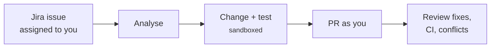

<p align="center"></p>

# ShadowDev

A team server that works on the Jira bugs and tasks assigned to you, **as you**: Claude Code
analyses the issue, changes the project's repos, their tests run in a sandbox, and a PR is opened
with your own GitHub token.



## Start here

| You want to | Read |
|---|---|
| know what it does, in two minutes | [FEATURES.md](FEATURES.md) |
| run it for the first time (Linux, macOS, Windows) | [INSTALL.md](INSTALL.md) |
| use it: accounts, projects, runs, switches, Slack reviews | [docs/USER-GUIDE.md](docs/USER-GUIDE.md) |
| run the server: `.env`, webhooks, backups, the key, deployment checklist | [docs/ADMIN.md](docs/ADMIN.md) |
| know what it guards and how | [docs/SAFETY.md](docs/SAFETY.md) |
| change its code: layout, layers, tests | [docs/ARCHITECTURE.md](docs/ARCHITECTURE.md), [CLAUDE.md](CLAUDE.md) |
| run it as a service | [deploy/README.md](deploy/README.md) |
| know what personal data it stores | [PRIVACY.md](PRIVACY.md) |

## In short

- One server for the whole team. Each developer signs in with Jira and connects their GitHub and
  Claude accounts, as many of each as they use (office and personal).
- Projects live on the web page: paste the repo URLs and Jira keys. Each developer joins with the
  accounts it should run with, and chooses what to automate.
- Python standard library plus `cryptography`. Claude and the tests run in a
  [bubblewrap](https://github.com/containers/bubblewrap) sandbox, and no code is kept after a run.

## Commands

`make` lists them all.

```bash
make up        # the server in the terminal (make upd: in the background; make down: stop)
make test      # all tests
make lint      # ruff
make dry S="Login button does nothing"   # the real pipeline on a made-up issue; nothing sent
make backup    # copy the database to data/backups/
```
